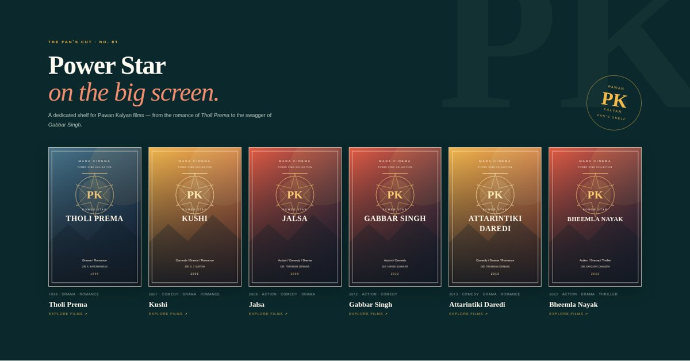

# Mana Cinema — Telugu Film Club

Mana Cinema is a Flask-based Telugu movie discovery and recommendation app. It combines a content-based recommender with an editorial-style interface inspired by Telugu cinema culture, plus a dedicated Pawan Kalyan fan shelf.

## Preview

The landing-page poster stage now places **Rangasthalam** (Ram Charan) on the left, **Jalsa** (Pawan Kalyan) in the centre, and **Baahubali 2: The Conclusion** (Prabhas) on the right.


**Power Star shelf**

**Explore by Hero** — filter the catalogue by the lead actor, then combine that selection with title, actor or director search.



**Mobile layout**


## Highlights

- Browse and search a curated collection of **35 Telugu films**.
- Dedicated Pawan Kalyan collection featuring *Tholi Prema*, *Kushi*, *Jalsa*, *Gabbar Singh*, *Attarintiki Daredi* and *Bheemla Nayak*.
- Get recommendations from a movie, selected genres, or a combination of both.
- Movie posters use movie-specific image sources only; failed images are removed from the visible catalogue rather than replaced with generated artwork.
- Responsive editorial interface with film shelves, live search, genre filters and recommendation cards.

## Run locally

Python 3.10 or later is recommended.

```bash
python -m venv .venv
```

Activate the environment:

```powershell
# Windows PowerShell
.\.venv\Scripts\Activate.ps1
```

```bash
# macOS / Linux
source .venv/bin/activate
```

Install dependencies and start the application:

```bash
python -m pip install -r requirements.txt
python app.py
```

Open **http://127.0.0.1:5000**.

## Recommendation approach

Each movie is represented using its genres, synopsis, director and cast. `TfidfVectorizer` converts those text features into vectors, and cosine similarity ranks candidate films.

- **Movie mode:** recommends films with similar content features.
- **Genre mode:** ranks films by selected-genre coverage and Jaccard overlap.
- **Combined mode:** adds a small ranking boost for selected genres while displaying the raw cosine-similarity score separately.

## Project structure

```text
Mana-Cinema/
├── app.py
├── requirements.txt
├── data/
│   └── movies.csv
├── templates/
│   └── index.html
├── static/
│   └── style.css
├── screenshots/
│   ├── mana-cinema-preview.jpg
│   ├── power-star-preview.jpg
│   └── mana-cinema-mobile-preview.jpg
├── tests/
│   └── test_recommender.py
├── requirements-dev.txt
├── .gitignore
└── LICENSE
```

## Poster image notes

Mana Cinema uses movie-specific poster URLs. The browser tries the primary URL and, when supplied, one alternate URL. If both fail, the affected movie card or hero-stage poster is hidden; no generated, generic, repeated or dubbed-language substitute is displayed. External image hosts can change availability, so the catalogue sync checks every poster URL and the browser performs a final runtime check.

Poster artwork remains the property of its respective rights holders. This is an independent student project and is not affiliated with the actors, studios, image hosts or rights holders. For public or commercial deployment, use posters that you have licensed or have permission to display.

## Tests

Install the optional development dependency and run:

```bash
python -m pip install -r requirements-dev.txt
python -m pytest -q
```

The dataset is manually curated and is not intended to be a complete Telugu film database.


## Poster availability policy

The catalogue currently contains 35 films with at least one poster image source recorded. Films without a poster source (including Magadheera and Mahanati in this revision) are excluded rather than shown with generated artwork. In the browser, a failed primary image gets one alternate-source attempt; if that also fails, the affected movie card is removed. External image hosts can change availability, so this runtime check is intentional.

## Expand the catalogue to up to 500 verified Telugu films

The TMDB sync discovers Telugu-original movies dynamically instead of relying on a short fixed candidate list. It sorts by popularity, paginates through TMDB results, fetches cast/director/genre metadata, checks that each movie's `original_language` is `te`, and verifies that the movie-specific poster URL returns image content. It stops after collecting the requested number of verified records or exhausting the available results. The final count can be below 500 when posters are unavailable.

1. Copy `.env.example` to `.env`.
2. Add your TMDB API Read Access Token to `TMDB_READ_ACCESS_TOKEN` in `.env`. Keep `.env` private; it is ignored by Git. Never paste the token into chat or commit it.
3. Install dependencies: `python -m pip install -r requirements.txt`.
4. Generate a reviewable catalogue of up to 500 films: `python scripts/sync_verified_telugu_catalog.py --limit 500`.
5. Inspect `data/movies_verified.csv` and `data/poster_exclusions.csv`.
6. Only after reviewing, apply it: `python scripts/sync_verified_telugu_catalog.py --limit 500 --apply`.

The script excludes records with missing poster paths, unavailable poster URLs, failed metadata lookups, duplicate titles, or a non-Telugu original language. The `--apply` option backs up the current dataset to `data/movies.before_verified_expansion.csv`. The existing Search by Hero / Explore by Hero interface uses the lead actor field generated from TMDB cast data, and the Pawan Kalyan shelf remains supported by the cast metadata.

TMDB is an external data provider. This project is independent and is not endorsed by TMDB. Poster rights remain with their respective owners; follow TMDB's terms, attribution requirements and image-use policies before public distribution.
