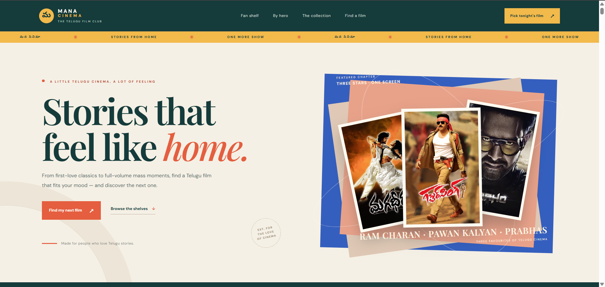
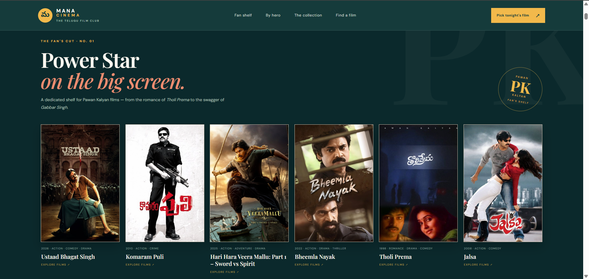
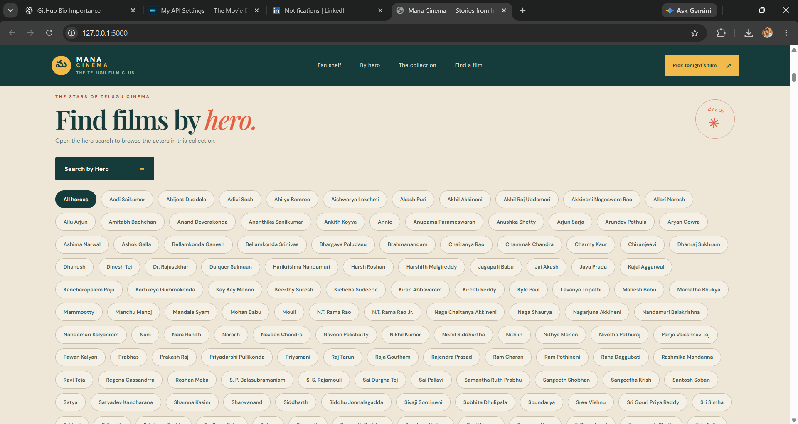
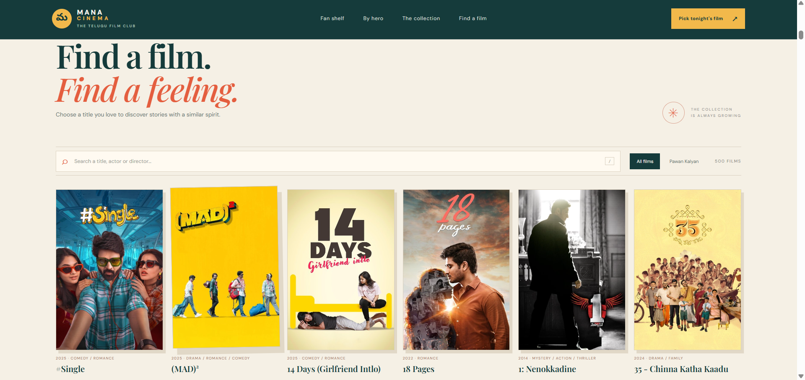
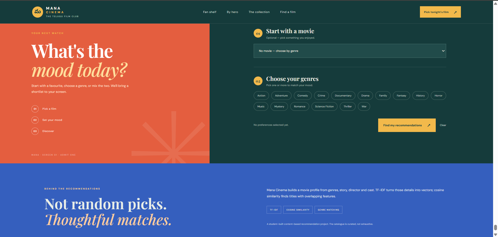
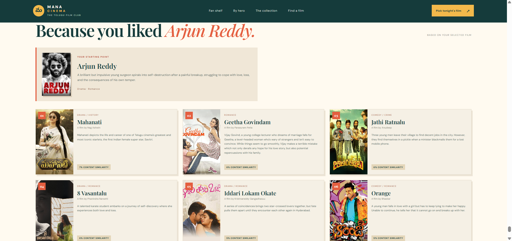
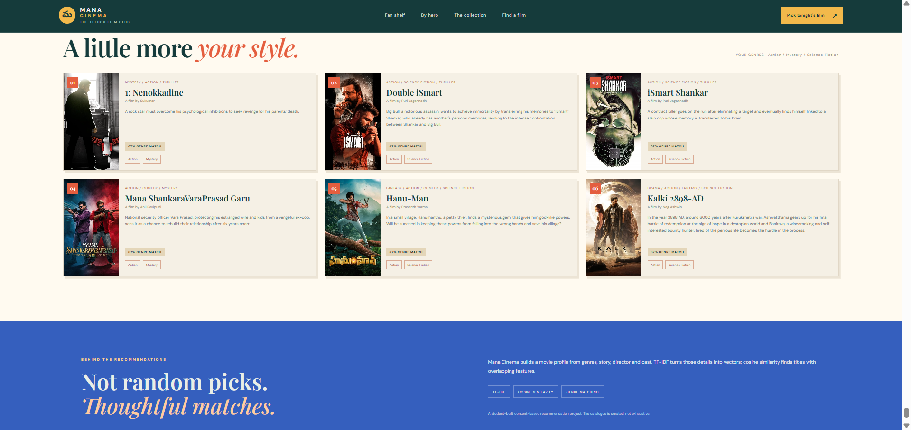
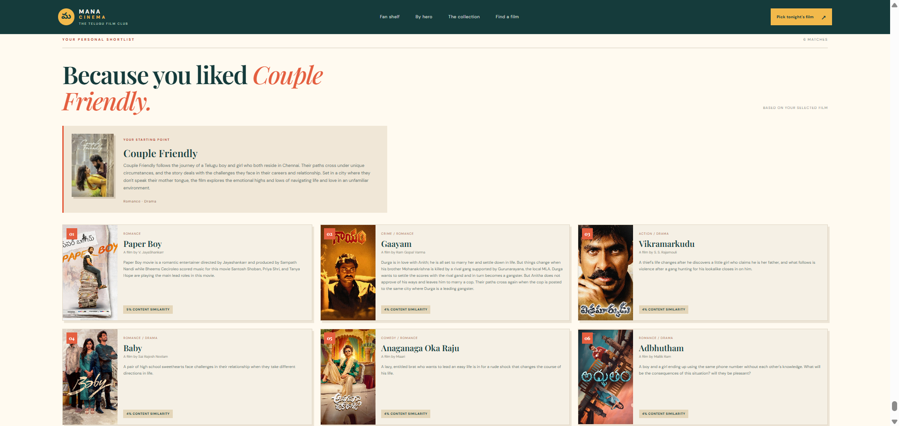
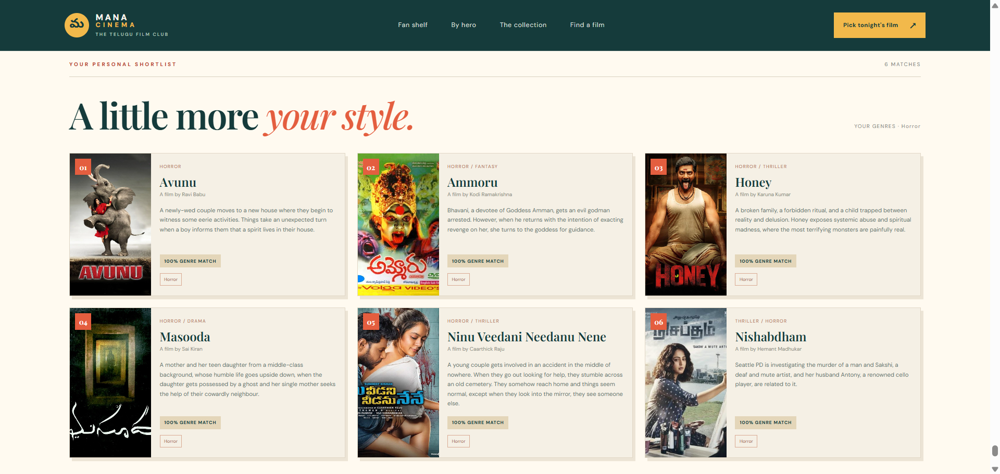
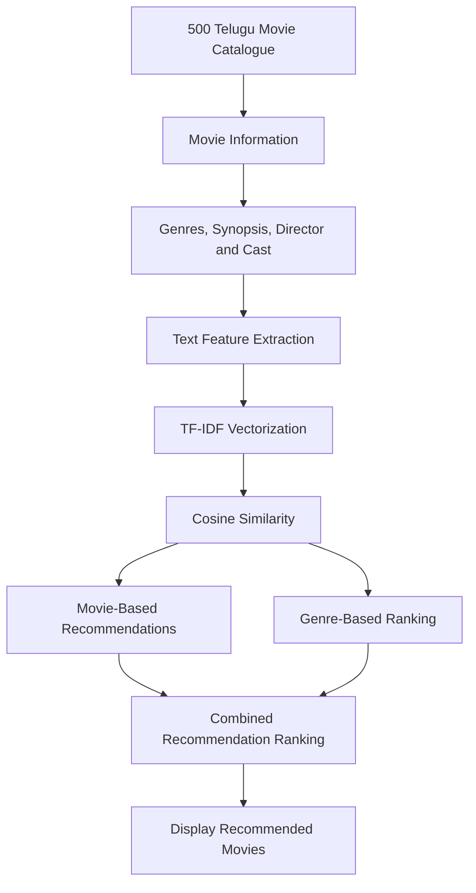

# MANA CINEMA — Telugu Film Club

A Flask-based Telugu movie discovery and recommendation platform featuring a catalogue of 500 Telugu films.

Discover movies, explore films by your favourite heroes, browse the Pawan Kalyan collection, and find your next favourite Telugu story through content-based recommendations.

**500 Films. Local Posters. Personalized Discoveries.**

---

## Preview

### 01. Homepage

Discover Telugu cinema through an editorial-style homepage featuring Ram Charan, Pawan Kalyan and Prabhas.



### 02. Pawan Kalyan Fan Shelf

Explore a dedicated collection of 12 Pawan Kalyan films.



### 03. Browse by Hero

Explore movies based on your favourite Telugu film actors.



### 04. Find a Film

Search and explore titles from the 500-film catalogue.



### 05. Mood-Based Discovery

Discover movies using your preferred genres and movie preferences.



### 06. Movie Recommendations

Get similar movie suggestions based on your selected title.



### 07. Personalized Picks

Explore additional recommendations based on your movie preferences.



### 08. Couple Friendly Recommendations



### 09. More Movie Recommendations



---

## Features

- **500-Movie Catalogue:** Explore a collection of 500 Telugu films.
- **Local Poster Library:** Movie posters are stored locally, allowing the application to run without making poster requests to an external API.
- **Hero-Based Browsing:** Discover movies through your favourite actors.
- **Pawan Kalyan Fan Shelf:** Dedicated collection featuring 12 films.
- **Featured Homepage:** Three-star showcase featuring Ram Charan, Pawan Kalyan and Prabhas.
- **Movie-Based Recommendations:** Find similar films using content similarity.
- **Genre-Based Discovery:** Explore movies by selecting one or more genres.
- **Combined Recommendations:** Combine a selected movie with preferred genres to influence recommendation ranking.
- **Generated Poster Artwork:** Local SVG poster artwork is available for catalogue titles through the application's poster-art route.
- **Responsive Interface:** Designed for an engaging movie discovery experience.

## Recommendation Workflow

Mana Cinema uses a content-based filtering approach to recommend Telugu movies.



### Recommendation Methods

**1. Movie-Based Recommendations**

- Select a movie from the catalogue.
- Extract its content features.
- Calculate similarity with other movies.
- Rank and display the top six recommendations.

**2. Genre-Based Recommendations**

- Select one or more preferred genres.
- Identify movies matching the selected genres.
- Rank movies based on genre coverage and overlap.
- Display the top recommendations.

**3. Combined Recommendations**

- Select a movie and preferred genres.
- Calculate movie similarity.
- Apply an additional ranking boost for matching genres.
- Display recommendations using the combined ranking.

## Technology Stack

| Technology | Purpose |
|---|---|
| Python | Backend programming |
| Flask | Web application framework |
| Pandas | Movie catalogue processing |
| Scikit-learn | Machine learning and recommendation engine |
| TF-IDF Vectorizer | Text feature extraction |
| Cosine Similarity | Movie similarity calculation |
| HTML5 | Webpage structure |
| CSS3 | Styling and responsive interface |
| TMDB API | Optional catalogue and poster updates |

## Getting Started

### Prerequisites

- Python 3.10 or newer
- pip package manager
- A modern web browser

### 1. Clone the Repository

```bash
git clone https://github.com/sivakumar9867/movie-recommendation-system.git
```

### 2. Navigate to the Project Folder

```bash
cd movie-recommendation-system
```

### 3. Create a Virtual Environment

**Windows:**

```powershell
python -m venv .venv
.venv\Scripts\activate
```

**macOS / Linux:**

```bash
python3 -m venv .venv
source .venv/bin/activate
```

### 4. Install Dependencies

```bash
pip install -r requirements.txt
```

### 5. Run the Application

```bash
python app.py
```

### 6. Open in Browser

Visit:

```text
http://127.0.0.1:5000
```

**Note:** The bundled movie catalogue and local posters are included in the repository. A TMDB API token is not required for normal application usage.

## Running Tests

Install development dependencies:

```bash
pip install -r requirements-dev.txt
```

Run the test suite:

```bash
python -m pytest -q
```

The test suite covers catalogue validation, the Pawan Kalyan collection, movie recommendations, genre filtering, combined recommendations and title slug generation.

## Optional Catalogue Refresh

The project includes scripts for synchronizing catalogue data and downloading verified posters.

To use TMDB for optional catalogue updates:

1. Copy `.env.example` to `.env`.
2. Add your TMDB API Read Access Token.
3. Run the relevant scripts in the `scripts/` directory.

Keep `.env` private. Never commit your API token to GitHub.

## Project Structure

```text
movie-recommendation-system/
│
├── app.py
├── requirements.txt
├── requirements-dev.txt
│
├── data/
│   └── movies.csv
│
├── scripts/
│   ├── sync_verified_telugu_catalog.py
│   └── download_verified_posters.py
│
├── templates/
│   └── index.html
│
├── static/
│   ├── style.css
│   └── posters/
│       └── 500 local poster images
│
├── screenshots/
│   ├── homepage-hero.png
│   ├── pawan-kalyan-fan-shelf.png
│   ├── browse-by-hero.png
│   ├── find-a-film.png
│   ├── mood-based-discovery.png
│   ├── recommendations-arjun-reddy.png
│   ├── recommendations-personalized-picks.png
│   ├── recommendations-couple-friendly.png
│   └── recommendations-more-films.png
│
├── tests/
│   └── test_recommender.py
│
├── .env.example
├── .gitignore
├── LICENSE
└── README.md
```

## Learning Outcomes

Through this project, I explored and practised:

- Building a full-stack web application using Python and Flask.
- Working with structured movie datasets using Pandas.
- Implementing content-based recommendation systems.
- Understanding TF-IDF vectorization and cosine similarity.
- Extracting useful features from movie descriptions and metadata.
- Implementing movie-based and genre-based recommendation methods.
- Managing and serving locally stored movie posters.
- Designing responsive user interfaces using HTML and CSS.
- Writing automated tests using Pytest.
- Managing project versions and documentation using Git and GitHub.

## Future Improvements

- Add user accounts and personalized watchlists.
- Introduce movie ratings and feedback.
- Improve recommendation quality with additional content features.
- Add advanced search and filtering options.
- Introduce language, year and rating-based filters.
- Add movie details pages with richer information.
- Explore collaborative filtering alongside content-based recommendations.
- Deploy the application to a cloud platform.

## Poster and Data Rights

Movie posters, promotional artwork and other third-party visual materials remain the property of their respective copyright owners.

Their inclusion in this project does not transfer ownership or grant permission for commercial use, republication or redistribution. The source-code licence does not automatically apply to third-party artwork.

Mana Cinema is an independent student project and is not affiliated with TMDB, film studios, actors or other rights holders.

## About the Project

**Mana Cinema — Telugu Film Club** is an independent project built to explore Telugu cinema through movie discovery and content-based recommendation techniques.

The project combines Python-based recommendation logic with a Flask web interface and a locally stored movie poster collection.

---

**Built with Python, Flask and ❤️ for Telugu Cinema.**
